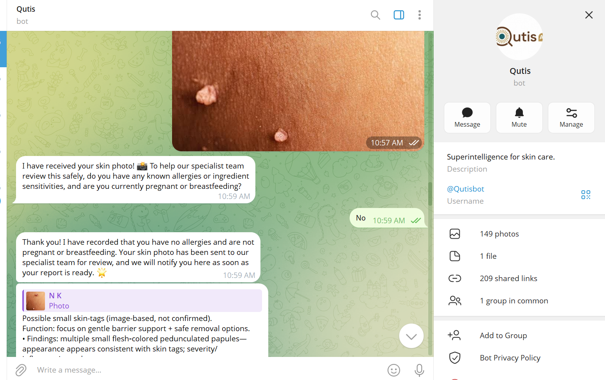

# Dermascan Agents



AI agent network for dermatology: conversational orchestration, image diagnosis, product safety review, and multi-channel delivery (Telegram / WhatsApp).

## Architecture at a Glance

```
user (Telegram / WhatsApp)
         │
         ▼
  Backend API (FastAPI, :8088)
         │ XADD orchestrator:jobs
         ▼
  Orchestrator worker ──► model chains (see §1)
         │                  Layer 0: primary (Gemini-first) or alternate (OpenAI-first)
         │                  Layer 1: walk chain L→R, breakers, 499/504 fallback, retries
         │                  Summarization uses the same Layer 0 choice per turn
         ├──► MedGemma gateway (vision, via orchestrator tools)
         ├──► rules engine (PostgreSQL) via signal enrichment
         │         report subagents: Gemini-first chain (REPORT_MODEL_CHAIN)
         └──► outbound:messages ──► Telegram / WhatsApp

  Reminders (optional, REMINDERS_ENABLED) ──► Postgres `reminders.*`
         │ poll due rows, 24h WhatsApp window
         ├──► outbound:messages (routine nudges)
         └──► orchestrator:signals (morning brief draft → orchestrator reply)
```

Workers are started together via `dermascan/scripts/do_work.py`. MedGemma runs as a separate AI-service stack (not included in that script).

## Prerequisites

- Python 3.12+
- [Poetry](https://python-poetry.org/)
- Redis (queues, job status, LangGraph checkpoints)
- PostgreSQL (rules engine ingredient safety data — required for product-review flows; also reminders and billing when enabled)
- Modal CLI (MedGemma GPU inference only)
- OpenAI API key (`OPENAI_API_KEY_QUTIS`) and Gemini credentials (`GEMINI_API_KEY_QUTIS` or Vertex AI)

## Setup

```bash
poetry install
cp .env_example .env   # fill in values — see sections below
```

### Local infrastructure

Rather than pointing at Redis Cloud and Cloud SQL, run both locally:

```bash
./dermascan/scripts/local_stack.sh up
```

This starts Redis and Postgres (Docker Compose, falling back to Homebrew
services), creates `qutis_db`, applies the billing migrations, and writes a
`.env.local` overlay that redirects `REDIS_URL` and `POSTGRES_*` at the local
stack while your `.env` keeps supplying API keys. Delete `.env.local` to go back
to the cloud. See `dermascan/docs/local-stack.md`.

## 1. LLM model chains

Orchestrator and summarization use **two stacked layers**:

| Layer | Module | Question |
|-------|--------|----------|
| **0 — Routing** | `model_chain_routing.py` | Which ordered playlist for this **turn**? Primary (Gemini-first) or alternate (OpenAI-first)? |
| **1 — Fallback** | `model_fallback_chain.py` | On this **step**, did model *n* fail in a retryable way → try model *n+1*? |

Report subagents use **Layer 1 only** (`REPORT_MODEL_CHAIN` in `product_rules_signal_helper.py`).

### Layer 1 — Within-chain fallback

On each LLM call the worker walks the active chain **left to right**. Retryable failures include timeouts, 504, **499/cancelled**, rate limits, and connection errors (see `should_fallback_to_next_model`). Each model has a **per-model circuit breaker** (`provider_circuit_breaker.py`); an open breaker skips that model for a short cooldown. Request-shaped errors (tool protocol, JSON parse, context length) do **not** open breakers.

When every model in the chain fails once, the worker waits `MODEL_CHAIN_RETRY_DELAY_S` and re-walks the **same** chain up to `MODEL_CHAIN_MAX_RETRIES` times.

### Layer 0 — Primary vs alternate chain (orchestrator + summarization)

Two parallel specs (comma-separated `provider:model_id`):

**Primary (default, cost-optimized)**

- Orchestrator — `ORCHESTRATOR_MODEL_CHAIN`:  
  `gemini:gemini-3.5-flash` → `gemini:gemini-3.1-flash-lite` → `openai:gpt-4o` → `openai:gpt-5`
- Summarization — `SUMMARIZATION_MODEL_CHAIN`:  
  `gemini:gemini-3.1-flash-lite` → `openai:gpt-4o-mini`

**Alternate (OpenAI-first escape hatch)**

- `ORCHESTRATOR_MODEL_CHAIN_ALT`:  
  `openai:gpt-4o-mini` → `openai:gpt-5-mini` → `gemini:gemini-3.1-flash-lite` → `gemini:gemini-3.5-flash`
- `SUMMARIZATION_MODEL_CHAIN_ALT`:  
  `openai:gpt-4o-mini` → `openai:gpt-5-mini` → `gemini:gemini-3.1-flash-lite`

**When alternate is selected**

1. **Fleet degraded** — After `MODEL_CHAIN_GEMINI_ERROR_THRESHOLD` Gemini health-style errors within `MODEL_CHAIN_GEMINI_ERROR_WINDOW_S`, Redis sets `model_chain:gemini_degraded` for `MODEL_CHAIN_GEMINI_DEGRADED_TTL_S`. New turns bind alternate until the key expires.
2. **Test override** — `MODEL_CHAIN_PREFER_PRIMARY=false` (or `off` / `0`) forces alternate on every turn without waiting for Redis.
3. **Turn stickiness** — At agent invoke start (`begin_model_chain_turn`), the mode is stored for that `request_id` so all tool-loop steps and summarization in the same turn share one playlist.

Gemini step failures feed the degraded counter via `ModelChainRunner.on_model_failure` → `notify_gemini_model_failure`.

### Orchestrator resilience (beyond chains)

- **Recursion retries** — on `GraphRecursionError`, reset the client checkpoint and retry the turn (`ORCHESTRATOR_RECURSION_MAX_RETRIES`).
- **Tool-call caps** — limit polling tools such as `get_time` and `read_status_of_a_case`.
- **Timeouts** — `GEMINI_REQUEST_TIMEOUT_S` (default 120s) per Gemini call; OpenAI uses `OPENAI_REQUEST_TIMEOUT_S`.

### Report subagents (Gemini first, then OpenAI)

Skin/product reports and ingredient extraction in `product_rules_signal_helper.py` use a **cost-optimized** chain:

```
gemini:gemini-3.5-flash → gemini:gemini-3.1-flash-lite
    → openai:gpt-4o-mini → openai:gpt-4o
```

Configure with `REPORT_MODEL_CHAIN`. Subagents also have per-tool limits and invoke retries (`REPORT_AGENT_*`).

### Reasoning models (gpt-5 / o-series)

OpenAI reasoning models consume output tokens for hidden reasoning. Set a higher budget so tool calls still fit:

| Variable | Purpose |
|---|---|
| `OPENAI_REASONING_MAX_TOKENS` | Max completion tokens for gpt-5 / o-series (default `8192`) |
| `OPENAI_REASONING_EFFORT` | Reasoning depth (default `minimal`) |

### Required credentials & tuning

| Variable | Purpose |
|---|---|
| `OPENAI_API_KEY_QUTIS` | OpenAI API key |
| `GEMINI_API_KEY_QUTIS` or Vertex | Gemini / Google AI |
| `GOOGLE_APPLICATION_CREDENTIALS_QUTIS` | Service account JSON for Vertex AI |
| `GOOGLE_CLOUD_PROJECT_QUTIS` | GCP project ID |
| `GOOGLE_CLOUD_LOCATION` | Vertex region (use `global` for Gemini 3.x) |
| `ORCHESTRATOR_GEMINI_THINKING_LEVEL` | Gemini thinking depth on non-lite models |
| `ORCHESTRATOR_MAX_TOKENS` | Default max output tokens per call (non-reasoning OpenAI) |
| `MODEL_CB_FAILURE_THRESHOLD` / `MODEL_CB_COOLDOWN_S` | Per-model circuit breaker |
| `MODEL_CHAIN_MAX_RETRIES` / `MODEL_CHAIN_RETRY_DELAY_S` | Full-chain retry when all models fail |
| `ORCHESTRATOR_MODEL_CHAIN_ALT` / `SUMMARIZATION_MODEL_CHAIN_ALT` | OpenAI-first alternate playlists |
| `MODEL_CHAIN_PREFER_PRIMARY` | `true` = normal; `false` = always alternate (testing) |
| `MODEL_CHAIN_GEMINI_ERROR_*` / `MODEL_CHAIN_GEMINI_DEGRADED_TTL_S` | When to set fleet degraded |
| `MODEL_CHAIN_TURN_STICKY_TTL_S` | Redis TTL for per-turn chain binding |
| `GEMINI_REQUEST_TIMEOUT_S` | HTTP deadline for each Gemini generate call |

Legacy `ORCHESTRATOR_OPENAI_MODEL`, `ORCHESTRATOR_GEMINI_MODEL`, and `REPORT_AGENT_MODEL` are ignored when the corresponding `*_MODEL_CHAIN` env vars are set.

Model temperature and token defaults also live in `dermascan/backend/services/agents/configurations/agents_config.json`.

## 2. PostgreSQL & rules engine

Product safety and skin-review signal enrichment call `RulesEngine` (`dermascan/rules_engine/engine/rules_engine.py`), which **queries PostgreSQL** for per-ingredient CIR safety data. Without a reachable Postgres instance and the variables below, product-review flows will fail at signal enrichment time.

Required variables (see `.env_example`):

| Variable | Purpose |
|---|---|
| `POSTGRES_HOST` | Database host |
| `POSTGRES_PORT` | Port (default `5432`) |
| `POSTGRES_DATABASE` | Database name |
| `POSTGRES_USER` | Username |
| `POSTGRESS_PASSWORD` | Password (note: double-S spelling matches code) |
| `POSTGRES_TABLE` | Ingredient table (default `cir_pdfs`) |

`REDIS_URL` is also required by the rules engine for ingredient-index caching.

## 3. Run the backend API

- Module: `dermascan/backend/app/main.py`
- Port: **8088**

```bash
poetry run uvicorn dermascan.backend.app.main:app --host 0.0.0.0 --port 8088 --reload
```

Active routes (prefix `/v1`):

- `GET /health`
- `POST /v1/orchestrator/requests`
- `POST /v1/orchestrator/requests/batch`
- `GET /v1/orchestrator/requests/{request_id}`
- `POST /v1/media/test/upload`
- `POST /v1/webhooks/whatsapp`
- `POST /v1/webhooks/telegram`

See `dermascan/backend/README.md` for webhook payload contracts and operational detail.

## 4. Run agent workers

Start orchestrator and outbound-sender workers in one process:

```bash
poetry run python dermascan/scripts/do_work.py
```

This script runs:

| Worker | Role |
|---|---|
| `orchestrator_worker` | Consumes jobs + signals; Layer 0 routing + Layer 1 chain walk with breakers |
| `outbound_sender_worker` | Compacts and delivers replies to Telegram / WhatsApp |
| `reminder_worker` | Polls Postgres for due morning briefs and routine reminders (`REMINDERS_ENABLED=true`) |

**Not included:** `knowledge_worker` (optional, start manually) and **MedGemma** (separate AI-service stack below).

### WhatsApp vs Telegram (v1)

| Capability | WhatsApp | Telegram |
|---|---|---|
| Orchestration & text outbound | Yes | Yes |
| Routine reminders & morning brief | Yes | Not yet — integration planned |
| Voice (ElevenLabs: voice notes in, TTS outbound) | Yes | Not yet — integration planned |

Telegram today supports the core chat path (text, images). **Reminders** and **voice** are implemented on **WhatsApp only**; Telegram support for both is on the roadmap.

### WhatsApp reminders (v1)

Routine habits and a daily **morning brief** are stored in Postgres (`dermascan/migrations/005_reminders.sql`, schema `reminders`). The orchestrator exposes tools: `set_morning_brief`, `set_routine_reminder`, `list_routines`, `disable_routine` (see `routine_tools.py` and the reminders section in `orchestrator_prompt.py`).

| Concern | Behavior |
|---|---|
| Channels | WhatsApp only in v1; schema and `channel` columns are ready for Telegram later |
| Delivery window | Outbound text only while the user is inside the **24h WhatsApp customer-care window** (updated on each inbound message) |
| Journey handoff | Reminders **pause** when the user leaves Nova for an external WhatsApp journey; **resume** when Nova ingress receives the next inbound user message |
| Timezone | Default `Africa/Nairobi` (`REMINDERS_DEFAULT_TIMEZONE`) |
| Morning brief catch-up | If a brief was missed, delivery is retried only during the **local morning band** (default 06:00–12:00, env-configurable) until grace expires |

**Enable locally**

1. Apply migration `005_reminders.sql` (included in `poetry run python -m dermascan.scripts.migrate`, or via `local_stack.sh` when migrations are wired).
2. Set `REMINDERS_ENABLED=true` and the same `POSTGRES_*` as billing.
3. Restart `do_work.py` — a `reminders` thread runs beside orchestrator and outbound workers.

Ingress touches (`record_channel_inbound`, pause/resume hooks) live in `dermascan/reminders/ingress_hooks.py` and are wired from WhatsApp webhooks and orchestrator handoff paths. Worker detail, env vars, and tick intervals: **`dermascan/backend/README.md`** (Reminders setup).

### Suggested local run order

1. `./dermascan/scripts/local_stack.sh up` — Redis, Postgres and migrations
2. Set `OPENAI_API_KEY_QUTIS` and Vertex/Gemini credentials in `.env`
3. MedGemma gateway + worker (if image / skin review flows are needed)
4. Backend API (`8088`)
5. `poetry run python dermascan/scripts/do_work.py`
6. (Optional) Telegram — see **§4.1 Run Telegram (local)** below

### 4.1 Run Telegram (local)

Telegram is **not** wired through Turn. For development you use **long polling** into the same ingress path production uses via webhook: `POST /v1/webhooks/telegram`. Replies go out through `outbound_sender_worker` in `do_work.py` via the Bot API `sendMessage`.

**Configure `.env`**

| Variable | Purpose |
|---|---|
| `TELEGRAM_BOT_TOKEN` | Bot token from [@BotFather](https://t.me/BotFather) |
| `TELEGRAM_LOCAL_WEBHOOK_URL` | Defaults to `http://127.0.0.1:8088/v1/webhooks/telegram` |
| `TELEGRAM_TEST_BOT_TOKEN` | Optional; when `TEST_MODE=true`, `load_env` can point outbound at a separate test bot |

Optional tuning: `TELEGRAM_HTTP_TIMEOUT_S`, `TELEGRAM_TLS_VERIFY`, `TELEGRAM_CA_BUNDLE`, `TELEGRAM_POLL_TIMEOUT_S`, `TELEGRAM_POLL_LIMIT`, `TELEGRAM_RETRY_DELAY_S`, `TELEGRAM_MEDIA_GROUP_WINDOW_S` (see `.env_example`).

**Run (typical dev)**

1. Redis up (`local_stack.sh` or `REDIS_URL` to Redis Cloud).
2. Start the API (§3).
3. Start workers — **orchestrator + outbound sender** are required for replies:

   ```bash
   poetry run python dermascan/scripts/do_work.py
   ```

4. In another terminal, start the **polling bridge** (calls `deleteWebhook`, then `getUpdates` → forwards each update to the local webhook):

   ```bash
   poetry run python dermascan/backend/services/agents/telegram_polling_bridge.py
   ```

5. Message your bot in Telegram (text or photo). Jobs land on `orchestrator:jobs`; replies are published to `outbound:messages` and sent back to the chat.

**Notes**

- Do not run BotFather `setWebhook` at the same time as the polling bridge — the bridge clears webhook mode on startup so `getUpdates` works.
- Photos: the API downloads the largest `photo[]` size via `getFile` and stores attachments for orchestrator / MedGemma paths (same as documented in `dermascan/backend/README.md`).
- **Reminders & voice:** see **§4 — WhatsApp vs Telegram (v1)**; Telegram does not deliver reminders or ElevenLabs voice yet.
- **Cloud staging** (when Cloud Run is deployed): a `dermascan-telegram-bridge-staging` service polls and forwards to the API URL; see `deploy/README.md`. No polling bridge needed on your laptop in that setup.

**Quick ingress check (without the bridge)**

```bash
curl -X POST http://127.0.0.1:8088/v1/webhooks/telegram \
  -H "Content-Type: application/json" \
  -d "{\"message\":{\"message_id\":1,\"from\":{\"id\":10001,\"username\":\"test_user\"},\"chat\":{\"id\":10001,\"type\":\"private\"},\"date\":1713000000,\"text\":\"Hello\"}}"
```

Expect `{"status":"queued",...}` when Redis is configured.

## 5. MedGemma (vision diagnosis — separate)

MedGemma is **not** started by `do_work.py`. It runs as its own async stack:

- **Gateway (FastAPI / uvicorn):** validates requests, enqueues to Redis
- **Worker:** consumes `medgemma:jobs`, calls Modal GPU inference
- **Modal app:** hosts `MedGemmaService` GPU methods

```bash
# Gateway
poetry run python -m uvicorn dermascan.ai_service.modal.medgemma_service.gateways.endpoints:web_app --host 0.0.0.0 --port 8080 --reload

# Worker
poetry run python dermascan/ai_service/modal/medgemma_service/worker.py
```

Set `MEDGEMMA_GATEWAY_URL=http://127.0.0.1:8080` in `.env` so orchestrator tools can reach the gateway.

Modal setup:

```bash
modal secret create huggingface HF_TOKEN=
modal secret create redis REDIS_HOST= REDIS_PORT= REDIS_USERNAME= REDIS_PASSWORD= REDIS_DB=
```

See `dermascan/ai_service/modal/medgemma_service/README.md` for gateway config.

## Project structure

| Directory | Purpose |
|---|---|
| `dermascan/backend` | API server, agent workers, orchestrator tools |
| `dermascan/backend/services/agents` | Workers, `model_fallback_chain.py`, `model_chain_routing.py`, circuit breakers |
| `dermascan/ai_service` | MedGemma Modal app, inference postprocessing |
| `dermascan/rules_engine` | PostgreSQL-backed ingredient safety engine |
| `dermascan/reminders` | Morning brief + routine reminders (Postgres, WhatsApp v1) |
| `dermascan/migrations` | SQL migrations (`005_reminders.sql` for reminders schema) |
| `dermascan/scripts` | Worker supervisor (`do_work.py`), `migrate.py`, utilities |
| `dermascan/shared` | Firebase storage, logging utilities |
| `dermascan/frontend` | Web UI and client-side application |

## Further reading

- `dermascan/Agents.md` — full agent map, signal flows, safety pipeline
- `dermascan/backend/README.md` — API, webhooks, worker details
- `dermascan/ai_service/docs/inference.md` — inference pipeline overview

## License

This project is licensed under the **PolyForm Noncommercial License 1.0.0**.

You are free to use, study, modify, and distribute this software for permitted non-commercial purposes, subject to the terms of the licence.

Commercial use, including commercial deployment, integration into commercial products, and commercial distribution, requires a separate written licence from the copyright holder.

For commercial licensing enquiries, contact: [kelvinndeti3142@gmail.com](mailto:kelvinndeti3142@gmail.com).

See [LICENSE](./LICENSE) for the complete licence terms.
