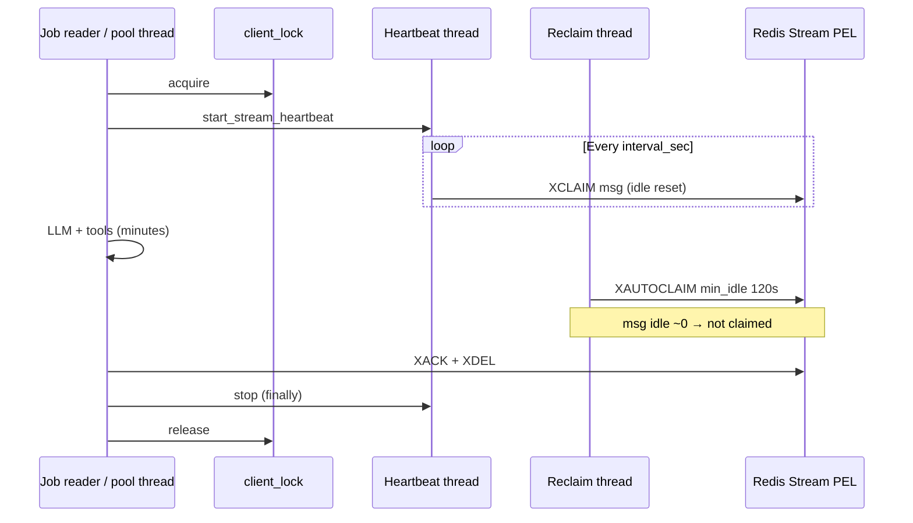

# Stream heartbeat (`heartbeat.py`)

This document explains the **stream message heartbeat** used by the orchestrator worker, and how it fits together with the **per-client Redis lock**, the **lock lease extender**, and **reclaim logic**. The implementation lives in `heartbeat.py`; wiring is in `orchestrator_worker.py` and recovery in `reclaim_logic.py`.

---

## Why this exists

Orchestrator work is driven by **Redis Streams consumer groups**:

| Stream | Typical work |
|--------|----------------|
| `orchestrator:jobs` | User turns (WhatsApp/Telegram ingress) |
| `orchestrator:signals` | Proactive updates (skin/product rules, reports) |
| `rules:index:jobs` | Async CIR PDF indexing (off hot orchestrator threads) |

A message stays **pending** from the moment a consumer reads it until **`XACK`**. Long turns (LLM calls, Gemini 429 retries, product rules + ingredient indexing) can run **many minutes** while the message remains unacked.

Separately, a background **reclaim loop** assumes: *if a message has been pending with no activity for longer than `WORKERS_STREAM_PENDING_MIN_IDLE_MS`, the original worker is probably dead — recover it.*

Without a heartbeat, a **healthy but slow** handler looks identical to a **crashed** worker. Reclaim may **re-run the same job or signal** while the first run is still active → duplicate rules-engine work, duplicate outbound attempts (partially deduped), and log noise such as `client lock busy; deferring job for reclaim`.

The heartbeat keeps the stream entry **visibly alive** to reclaim while processing continues.

---

## Part 1 — Per-client lock (jobs only)

### What problem it solves

Job turns for the same **`client_id`** share one **LangGraph checkpoint** (`thread_id=client_id`, `checkpoint_ns="orchestrator"`). Two pool threads processing two jobs for the same phone at once can corrupt checkpoint state (tool-call mismatches, recursion loops).

### What it does

Before running the agent, `_process_stream_message` acquires a Redis lock:

- **Key:** `orchestrator:client_lock:{client_id}` (prefix configurable via `ORCHESTRATOR_CLIENT_LOCK_KEY_PREFIX`).
- **Lease:** `ORCHESTRATOR_CLIENT_LOCK_LEASE_SEC` (default **180s**). The lock auto-expires if the holder never releases it (crash safety).
- **Wait:** Blocks up to `ORCHESTRATOR_CLIENT_LOCK_WAIT_SEC` (default **60s**) for the lock.
- **`thread_local=False`:** Required because the lock is **acquired on an `orch-worker_*` thread** but **extended on a dedicated extender thread** (see below). With `thread_local=True`, extend/release from another thread breaks ownership.

### Outcomes

| Result | Behavior |
|--------|----------|
| Lock acquired | Turn proceeds; extender + heartbeat start. |
| Wait timeout | Handler **returns without `XACK`**. Message stays pending; reclaim may retry later. Log: `client lock busy; deferring job for reclaim`. |

**Signals do not use this lock.** Signal handling uses a separate checkpoint namespace (`orchestrator:signal`) and only runs the **signal stream heartbeat** (no client serialization lock).

---

## Part 2 — Lock lease extender (jobs only)

### Why extend?

The initial lock lease (e.g. 180s) can be **shorter than a single turn** when:

- The model chain retries on **429 RESOURCE_EXHAUSTED**,
- Fallback models run,
- Tools add latency.

If the lease expired mid-turn, another worker could acquire the lock and start a **second turn for the same client** while the first is still running.

### What it does

After lock acquisition, `_start_client_lock_extender` runs a **daemon thread** that periodically calls:

```text
lock.extend(CLIENT_LOCK_LEASE_SEC, replace_ttl=True)
```

Interval: about **one third of the lease** (minimum 5s).

### Crash behavior

If the process or thread dies, extension stops. The lock **expires within one lease** — no permanent deadlock on `client_id`.

### Relationship to heartbeat

| Mechanism | Protects |
|-----------|----------|
| **Lock + extender** | **One logical conversation turn per client** (checkpoint integrity). |
| **Stream heartbeat** | **One consumer “owns” this stream message** for reclaim purposes (no duplicate handler from reclaim). |

They address **different resources**: client conversation state vs. stream pending entry.

---

## Part 3 — Stream heartbeat (`heartbeat.py`)

### API

- **`compute_heartbeat_interval_sec(pending_min_idle_ms, lease_sec=None)`**  
  Chooses a beat interval ≈ **⅓** of the smaller relevant deadline (reclaim idle threshold, and for jobs also lock lease), floored at **5 seconds**. Defaults are wired in `orchestrator_worker.py` as `JOB_HEARTBEAT_INTERVAL_SEC` and `SIGNAL_HEARTBEAT_INTERVAL_SEC` (overridable via env).

- **`start_stream_heartbeat(redis_client, stream, group, consumer, msg_id, interval_sec)`**  
  Starts a daemon thread; returns a **`threading.Event`** used to stop the heartbeat in a `finally` block.

### What each beat does

On each interval (until stop is set):

```text
XCLAIM <stream> <group> <consumer> 0 <msg_id> JUSTID
```

(`min_idle_time=0` in redis-py.)

Effect:

- The message remains assigned to the **same consumer name** that started the turn.
- Its **idle time in the pending entries list is reset**.

Reclaim uses **`XAUTOCLAIM`** with **`min_idle_ms = WORKERS_STREAM_PENDING_MIN_IDLE_MS`** (default **120000 ms**). Messages whose idle time stays below that threshold are **not** candidates for reclaim. Regular heartbeats keep idle time near zero while work is in progress.

### Error handling

A failed beat logs a warning and **does not** abort the turn. If Redis is down for long enough that idle time exceeds the threshold, the message becomes reclaimable again — the **safe** failure mode (prefer recovery over silent loss).

### Where it is started

**Job handler** (`_process_stream_message`), **after** lock + lock extender:

```text
acquire client lock → start lock extender → start stream heartbeat → agent/tools → XACK → finally: stop heartbeat, stop extender, release lock
```

**Signal handler** (`_process_signal_message`), **before** the main `try` (no client lock):

```text
start stream heartbeat → rules/agent → XACK → finally: stop heartbeat
```

If job lock acquisition fails, **no heartbeat** is started (message left pending intentionally).

---

## Part 4 — Reclaim logic (`reclaim_logic.py`)

### How reclaim operates

A dedicated thread per stream runs every **`WORKERS_RECLAIM_INTERVAL_SEC`** (default **30s**):

1. **`XAUTOCLAIM`** messages pending longer than **`WORKERS_STREAM_PENDING_MIN_IDLE_MS`**.
2. For each claimed message:
   - If **`is_processed`**: ack + delete (cleanup).
   - Else increment **`orchestrator:reclaim_attempts:{stream}:{msg_id}`**; over **`WORKERS_MAX_RECLAIM_ATTEMPTS`** → DLQ.
   - Else invoke the **handler** (same `_process_stream_message` or `_process_signal_message` as the main reader).

On the **reclaim path** for jobs, the orchestrator wraps the handler with **`mark_processed` before invoke** (reclaim-specific idempotency). The **normal reader path** marks processed **after** successful completion.

### Reclaim during an in-flight job (with heartbeat)



**Without heartbeat**, once idle &gt; 120s while the reader is still working, reclaim **claims the same `msg_id`**. For jobs, reclaim may hit **`client lock busy`** (original still holds lock) or, in worse cases, duplicate processing paths. For signals, reclaim could **start a second full rules flow** (indexing + LLM) in parallel.

### Reclaim when heartbeat stops (crash or finally)

When the worker **crashes** or **`heartbeat_stop.set()`** runs in `finally`:

- Heartbeats cease (or never started).
- Pending **idle time increases**.
- After **`PENDING_MIN_IDLE_MS`**, reclaim treats the message as stale and re-delivers it.

That is intentional: **recovery for dead consumers**.

For **jobs**, the **client lock** also expires after **`CLIENT_LOCK_LEASE_SEC`** without extension, so a reclaimed job can eventually acquire the lock and complete.

For **signals**, there is no client lock; heartbeat + `mark_processed` / outbound dedupe are the main guards against duplicate user-visible sends.

---

## Part 5 — Failure and crash scenarios

| Scenario | Lock | Lock extender | Heartbeat | Reclaim |
|----------|------|---------------|-----------|---------|
| Normal slow turn | Held | Extending | Beating | Skips message (low idle) |
| Lock wait timeout | Not held | Not started | Not started | May reclaim later; defer log |
| Process kill mid-turn | Stops extending; expires | Stops | Stops | Reclaims after idle threshold |
| Redis blip on heartbeat | Unchanged | Unchanged | Warn; retry next beat | May reclaim if idle exceeds threshold |
| Reclaim runs duplicate handler | Second job waits on lock | — | — | `client lock busy` on job path |
| Handler finishes | Released in `finally` | Stopped | Stopped | `mark_processed` prevents double reclaim handle |

**Important:** Heartbeat does **not** replace ack. Success still requires **`XACK` + `XDEL`** (and `mark_processed` on the happy path). Heartbeat only prevents **premature** reclaim during long **in-flight** work.

---

## Part 6 — Configuration checklist

| Variable | Default | Role |
|----------|---------|------|
| `WORKERS_STREAM_PENDING_MIN_IDLE_MS` | `120000` | Reclaim staleness threshold |
| `WORKERS_RECLAIM_INTERVAL_SEC` | `30` | How often reclaim runs |
| `WORKERS_MAX_RECLAIM_ATTEMPTS` | `3` | Before DLQ |
| `ORCHESTRATOR_CLIENT_LOCK_LEASE_SEC` | `180` | Lock TTL; extender refreshes |
| `ORCHESTRATOR_CLIENT_LOCK_WAIT_SEC` | `60` | Max block waiting for lock |
| `ORCHESTRATOR_JOB_HEARTBEAT_INTERVAL_SEC` | auto | Override job beat cadence |
| `ORCHESTRATOR_SIGNAL_HEARTBEAT_INTERVAL_SEC` | auto | Override signal beat cadence |
| `INDEX_WORKER_MAX_INFLIGHT` | `1` | Serial CIR index jobs (PDF + embed) |
| `RULES_INDEX_BATCH_TIMEOUT_SEC` | `3600` | Watchdog log if final pass waits too long |

**Rules index stream:** `indexing_worker.py` uses the same `compute_heartbeat_interval_sec(PENDING_MIN_IDLE_MS)` cadence on each `rules:index:jobs` message while PDF indexing runs (often several minutes). Without heartbeat, reclaim could re-deliver index jobs mid-upload.

**Coordination tip:** Set **`PENDING_MIN_IDLE_MS` comfortably above** expected worst-case turn time **or** rely on heartbeat so idle never crosses the threshold. Example from `.env_example`: **300000 ms** idle with **180 s** lock lease. Heartbeat interval is derived to beat **before** those limits (≈⅓ of the tighter bound).

---

## Part 7 — Mental model (one paragraph)

**Lock + extender** answer: *“Only one orchestrator job turn per WhatsApp/Telegram client at a time, even if the LLM takes ten minutes.”* **Heartbeat** answers: *“This stream message is still being processed by this consumer; do not treat it as abandoned.”* **Reclaim** answers: *“If the consumer really died and idle time grew, re-run the handler (with idempotency markers and DLQ limits).”* Together they reduce duplicate turns from slow Gemini/product flows without sacrificing crash recovery.

---

## Related files

| File | Responsibility |
|------|----------------|
| `heartbeat.py` | Interval math + `XCLAIM` liveness thread |
| `orchestrator_worker.py` | Lock, extender, heartbeat wiring, handlers |
| `reclaim_logic.py` | `XAUTOCLAIM`, processed markers, attempt limits |
| `outbound_sender_worker.py` | Dedupe on duplicate enqueues (separate layer) |
| `indexing_worker.py` | CIR index consumer + heartbeat on index jobs |
| `rules_index_jobs.py` | Enqueue, batch coordination, index-ready signal |
| `index_worker.md` | Async index ops runbook (DLQ replay, env flags) |
