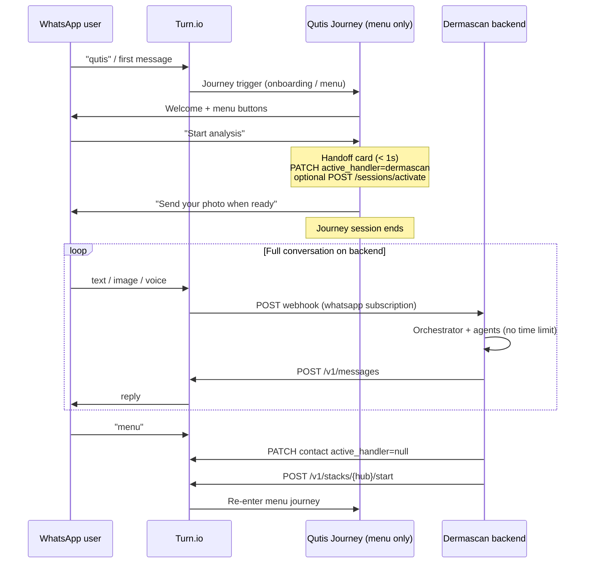

# Turn.io Relay Integration — Dermascan Backend

> **PDF:** [`turn/relay_integration.pdf`](relay_integration.pdf) — regenerate with  
> `poetry run python turn/scripts/md_to_pdf.py`

Turn.io is the **WhatsApp transport layer**. Dermascan owns **all conversation logic** (agents, tools, MedGemma, session state, routing).

Turn's job:

- Deliver inbound WhatsApp events to your backend (webhook)
- Send outbound messages your backend requests (`POST /v1/messages`)

Turn is **not** the conversational brain during an active Dermascan session.

**Related docs:** [`turnio.md`](../turnio.md) (platform overview) · [`turn/journeys/qutis.md`](journeys/qutis.md) (menu/onboarding)

---

## Architecture



### Responsibility split

| Layer | Owns |
|-------|------|
| **Turn Journey (Qutis)** | Onboarding, welcome, menus, consent copy, handoff message |
| **Turn webhook → Dermascan** | All multi-turn chat after handoff |
| **Dermascan orchestrator** | Agents, analysis, reports, escalation, session memory |
| **Turn `POST /v1/messages`** | Delivery to WhatsApp only |

### What NOT to do

Do **not** run the full agent conversation inside a Journey `post()` loop. Journey HTTP calls have a **20s hard ceiling** and an active Journey session can block normal webhook delivery.

Use Journeys for **entry + handoff**, then **release the session** so inbound messages flow via the `whatsapp` webhook subscription.

---

## Connection setup

### 1. Turn primary webhook → Dermascan ingress

Register your backend as Turn's **primary application webhook**:

```http
PATCH https://whatsapp.turn.io/v1/settings/application
Authorization: Bearer <TURN_API_TOKEN>
Content-Type: application/json

{
  "webhook_url": "https://your-backend.example.com/v1/webhooks/whatsapp"
}
```

Subscribe to the **`whatsapp`** subscription (inbound messages + delivery statuses).

### 2. Dermascan outbound → Turn Messages API

Point the outbound worker (or a thin adapter) at Turn instead of the 360Dialog sidecar:

| Env var | Turn value |
|---------|------------|
| `WHATSAPP_API_BASE_URL` | `https://whatsapp.turn.io` |
| `WHATSAPP_API_SEND_PATH` | `/v1/messages` |
| Auth | `Authorization: Bearer <TURN_API_TOKEN>` |

Or run the repo **Turn sidecar adapter** (implements `/send` + `/typing` → Turn API):

```bash
poetry run uvicorn turn.scripts.turn_sidecar_adapter:app --host 0.0.0.0 --port 8000
```

Set `WHATSAPP_API_BASE_URL=http://127.0.0.1:8000`, `WHATSAPP_API_SEND_PATH=/send`, `TURN_API_TOKEN`, and the same `WHATSAPP_INTERNAL_API_SECRET` as the outbound worker. Optional inbound relay: `NOVA_WEBHOOK_URL=http://127.0.0.1:8088/v1/webhooks/whatsapp` + `TURN_WEBHOOK_SECRET`, then register ngrok to the adapter instead of Nova.

The adapter also:

- Verifies `X-Turn-Hook-Signature` on inbound (relay mode)
- Forwards payloads to `POST /v1/webhooks/whatsapp` with `X-Internal-Secret`
- Translates sidecar `{to, kind, text}` → Turn `POST /v1/messages` JSON

### 3. Journey handoff (menu → backend)

When the user selects **Start analysis** (or equivalent):

1. Journey sets contact field `active_handler = "dermascan"` (via Turn Contacts API)
2. Optional: `POST /v1/sessions/activate` on Dermascan (< 1s ACK)
3. Journey sends a short handoff message and **ends** (no active session)
4. All subsequent messages hit the `whatsapp` webhook → Dermascan

---

## Inbound: Turn → Backend

### HTTP request

```http
POST /v1/webhooks/whatsapp
Content-Type: application/json
X-Turn-Hook-Subscription: whatsapp
X-Turn-Hook-Signature: <base64 HMAC-SHA256 of raw body>
X-Internal-Secret: <your ingress secret>   # if using adapter → Dermascan
```

**Requirements:**

- Respond **2xx within 5 seconds** (enqueue to Redis, process async)
- Verify `X-Turn-Hook-Signature` with your Turn webhook secret
- Deduplicate on `message.id` (Turn may retry)

### HMAC verification

```
expected = base64( HMAC_SHA256( webhook_secret, raw_request_body ) )
compare constant-time with X-Turn-Hook-Signature
```

Return **401** on bad signature (Turn will not retry).

---

### Webhook body shapes

Turn forwards **Meta WhatsApp Cloud API** events. Dermascan's ingress accepts both nested and flat shapes via `_extract_whatsapp_messages()`.

#### Shape A — Cloud API nested (most common from Turn)

```json
{
  "object": "whatsapp_business_account",
  "entry": [{
    "id": "<WABA_ID>",
    "changes": [{
      "field": "messages",
      "value": {
        "messaging_product": "whatsapp",
        "metadata": {
          "display_phone_number": "27600136875",
          "phone_number_id": "<PHONE_NUMBER_ID>"
        },
        "contacts": [{
          "profile": { "name": "Jane Doe" },
          "wa_id": "254712345678"
        }],
        "messages": [{
          "from": "254712345678",
          "id": "wamid.HBgLM...",
          "timestamp": "1726840800",
          "type": "text",
          "text": { "body": "I have a rash on my arm" }
        }]
      }
    }]
  }]
}
```

#### Shape B — Flat top-level (also seen on Turn)

```json
{
  "contacts": [{ "profile": { "name": "Jane Doe" }, "wa_id": "254712345678" }],
  "messages": [{
    "from": "254712345678",
    "id": "wamid.HBgLM...",
    "timestamp": "1726840800",
    "type": "text",
    "text": { "body": "hello" }
  }]
}
```

#### Shape C — Legacy single-message wrapper (supported by Dermascan)

```json
{
  "entry": [{
    "changes": [{
      "value": {
        "message": {
          "from": "254712345678",
          "id": "wamid.HBgLM...",
          "type": "text",
          "text": { "body": "Please diagnose this" }
        }
      }
    }]
  }]
}
```

---

### Inbound message types

#### Text

```json
{
  "from": "254712345678",
  "id": "wamid.HBgLM...",
  "timestamp": "1726840800",
  "type": "text",
  "text": { "body": "What is this spot on my cheek?" }
}
```

#### Image (skin analysis)

```json
{
  "from": "254712345678",
  "id": "wamid.HBgLM...",
  "timestamp": "1726840800",
  "type": "image",
  "image": {
    "id": "media-uuid-from-turn",
    "mime_type": "image/jpeg",
    "sha256": "abc123...",
    "caption": "Rash on upper arm"
  }
}
```

**Media resolution:** Dermascan stores `image.id` as `whatsapp_media_id`. Fetch bytes before analysis:

```http
GET https://whatsapp.turn.io/v1/media/{image.id}
Authorization: Bearer <TURN_API_TOKEN>
```

#### Interactive button reply (from Journey/menu buttons)

```json
{
  "from": "254712345678",
  "id": "wamid.HBgLM...",
  "timestamp": "1726840800",
  "type": "interactive",
  "interactive": {
    "type": "button_reply",
    "button_reply": {
      "id": "SkinAnalysis",
      "title": "Skin analysis"
    }
  }
}
```

Map `button_reply.title` or `button_reply.id` to intent in your router. During an active Dermascan session, treat `"menu"` as exit-to-hub.

#### Interactive list reply

```json
{
  "from": "254712345678",
  "id": "wamid.HBgLM...",
  "type": "interactive",
  "interactive": {
    "type": "list_reply",
    "list_reply": {
      "id": "start_analysis",
      "title": "Start analysis",
      "description": "Send a skin photo"
    }
  }
}
```

#### Document

```json
{
  "from": "254712345678",
  "id": "wamid.HBgLM...",
  "type": "document",
  "document": {
    "id": "media-uuid",
    "mime_type": "application/pdf",
    "filename": "lab_result.pdf",
    "caption": "optional caption"
  }
}
```

#### Delivery status (same `whatsapp` subscription)

Not queued to orchestrator today — use for observability:

```json
{
  "statuses": [{
    "id": "wamid.outbound-id",
    "status": "sent",
    "timestamp": "1726840900",
    "recipient_id": "254712345678"
  }]
}
```

Possible values: `sent`, `delivered`, `read`, `failed`.

---

### Dermascan internal normalization

After ingress, `_normalize_message()` in `dermascan/backend/api/endpoints.py` maps Turn/Meta fields to:

```json
{
  "request_id": "a1b2c3...",
  "case_id": "a1b2c3...",
  "client_id": "254712345678",
  "message_id": "wamid.HBgLM...",
  "conversation_id": "254712345678",
  "channel": "whatsapp",
  "content": {
    "text": "I have a rash on my arm",
    "attachments": [{
      "id": "media-uuid-from-turn",
      "type": "image",
      "mime_type": "image/jpeg",
      "source": { "kind": "whatsapp_media_id", "value": "media-uuid-from-turn" }
    }]
  },
  "metadata": { "extras": { "whatsapp_type": "text" } }
}
```

| Turn / Meta field | Dermascan field |
|-------------------|-----------------|
| `message.from` | `client_id`, `conversation_id` |
| `message.id` | `message_id` |
| `text.body` | `content.text` |
| `image.id` | attachment `source.kind = whatsapp_media_id` |
| `image.caption` | appended to `content.text` |
| `message.type` | `metadata.extras.whatsapp_type` |

**Ingress ACK response** (return immediately):

```json
{
  "status": "queued",
  "queued_count": 1,
  "request_ids": ["a1b2c3..."]
}
```

---

## Outbound: Backend → Turn → WhatsApp

All outbound replies use Turn's Messages API. Dermascan's outbound worker currently calls a sidecar; with Turn, call Turn directly or via an adapter.

### Text message (primary)

```http
POST https://whatsapp.turn.io/v1/messages
Authorization: Bearer <TURN_API_TOKEN>
Content-Type: application/json

{
  "recipient_type": "individual",
  "to": "254712345678",
  "type": "text",
  "text": { "body": "Thanks for the photo. I'm reviewing it now." },
  "preview_url": false
}
```

**Response:**

```json
{
  "messages": [{ "id": "wamid.HBgLO..." }]
}
```

Store the returned `id` if you need delivery tracking.

| Sidecar (current) | Turn equivalent |
|-------------------|-----------------|
| `{ "to": "254...", "kind": "text", "text": "..." }` | `{ "to": "254...", "type": "text", "text": { "body": "..." } }` |
| `reply_to_wamid` | `"context": { "message_id": "wamid.inbound..." }` |

### Reply threading (progress updates)

```json
{
  "to": "254712345678",
  "type": "text",
  "context": { "message_id": "wamid.inbound-id" },
  "text": { "body": "Analyzing your photo..." }
}
```

Alternative audit header (Turn does not validate the value):

```http
X-Turn-In-Reply-To: <your-external-correlation-id>
```

### Typing indicator

Replace sidecar `POST /typing`:

```http
PUT https://whatsapp.turn.io/v1/messages/{inbound_wamid}
Authorization: Bearer <TURN_API_TOKEN>
Content-Type: application/json

{
  "status": "read",
  "typing_indicator": { "type": "text" }
}
```

Auto-clears after ~25s or when the next message is sent.

### Image outbound

```json
{
  "to": "254712345678",
  "type": "image",
  "image": {
    "link": "https://your-cdn.example.com/report-annotated.jpg",
    "caption": "Annotated areas of concern"
  }
}
```

Or upload first via `POST /v1/media`, then reference by id.

### Interactive buttons (optional — e.g. return to menu)

```json
{
  "to": "254712345678",
  "type": "interactive",
  "interactive": {
    "type": "button",
    "body": { "text": "Would you like anything else?" },
    "action": {
      "buttons": [
        { "type": "reply", "reply": { "id": "menu", "title": "Main menu" } },
        { "type": "reply", "reply": { "id": "done", "title": "I'm done" } }
      ]
    }
  }
}
```

WhatsApp allows **max 3** reply buttons.

---

## Identity and session continuity

Dermascan is the **system of record** for conversation state. Turn provides stable user identity.

| Identifier | Source | Use |
|------------|--------|-----|
| `client_id` / `wa_id` | `message.from` | Primary key for WhatsApp user (E.164 digits, no `+`) |
| Turn contact UUID | Contacts API / webhook context | Platform profile fields (`active_handler`, consent) |
| Dermascan `case_id` | Generated per ingress job | Internal orchestrator case |
| Dermascan session | Redis / your DB | Agent memory, analysis state |

**Recommended:** key sessions on `client_id` (phone). No Turn-side session field required unless the platform also routes via a gateway.

Optional contact fields (platform-owned):

| Field | Type | Purpose |
|-------|------|---------|
| `active_handler` | string | `"dermascan"` \| `"platform"` \| null — webhook router |
| `dermascan_consent` | boolean | Consent captured in Journey |

---

## Optional: POST gateway contract

If a platform adapter sits between Turn and Dermascan (or you expose a single relay endpoint), use this contract.

### Gateway request (adapter → Dermascan)

```http
POST https://your-backend.example.com/v1/webhooks/whatsapp
X-Internal-Secret: <secret>
Content-Type: application/json
```

```json
{
  "relay": {
    "provider": "turn",
    "turn_contact_uuid": "550e8400-e29b-41d4-a716-446655440000",
    "journey_uuid": null,
    "journey_session_uuid": null
  },
  "entry": [{
    "changes": [{
      "value": {
        "messages": [{
          "from": "254712345678",
          "id": "wamid.HBgLM...",
          "type": "text",
          "text": { "body": "user message here" }
        }]
      }
    }]
  }]
}
```

The `messages[]` object should remain **Meta-shaped** so existing `_normalize_message()` works unchanged. Extra `relay` metadata is optional.

### Gateway response (immediate ACK)

Same as ingress today — **not** the agent reply:

```json
{ "status": "queued", "queued_count": 1, "request_ids": ["..."] }
```

Agent replies are always sent **asynchronously** via `POST /v1/messages`, never in the webhook response body.

### Session activate (Journey handoff only)

Fast endpoint called from Journey handoff card (< 1s):

```http
POST https://your-backend.example.com/v1/sessions/activate
X-Internal-Secret: <secret>
Content-Type: application/json

{
  "wa_id": "254712345678",
  "turn_contact_uuid": "550e8400-e29b-41d4-a716-446655440000",
  "service": "dermascan",
  "source": "qutis_journey"
}
```

**Response:**

```json
{
  "status": "activated",
  "session_id": "sess_abc123"
}
```

No AI work here — only prime Redis/session routing so the next inbound webhook is handled immediately.

---

## Routing rules

```
Inbound webhook received
  │
  ├─ statuses[] only?          → log / metrics, return 200
  │
  ├─ active Journey session?   → Turn delivers to Journey (not your webhook)
  │                              Keep Journey sessions SHORT (menu/handoff only)
  │
  └─ no active Journey         → whatsapp webhook → Dermascan
       │
       ├─ active_handler == "dermascan"  → orchestrator
       ├─ active_handler == null        → ignore OR restart Qutis menu journey
       └─ user says "menu" during Dermascan
            → clear handler, POST /v1/stacks/{qutis_uuid}/start
```

---

## Security checklist

| Item | Implementation |
|------|----------------|
| Webhook authenticity | Verify `X-Turn-Hook-Signature` |
| Backend ingress | `X-Internal-Secret` between adapter and Dermascan |
| Turn API token | Bearer token in env / secret manager — never in Journey code |
| Gateway secrets | Turn Secrets + `turn.secrets.get()` in function skills (if used) |
| PII | Phone numbers in logs — mask in non-prod |

---

## Environment variables (Turn relay)

```bash
# Turn
TURN_API_BASE_URL=https://whatsapp.turn.io
TURN_API_TOKEN=<bearer token from Turn UI>
TURN_WEBHOOK_SECRET=<from Settings → API & Webhooks>

# Dermascan ingress (unchanged)
WHATSAPP_INGRESS_SECRET=<internal secret>

# Outbound — point at Turn (direct or via adapter)
WHATSAPP_API_BASE_URL=https://whatsapp.turn.io
WHATSAPP_API_SEND_PATH=/v1/messages
WHATSAPP_API_TYPING_PATH=/v1/messages   # adapter maps to PUT /v1/messages/{id}

# Journey IDs (for return-to-menu)
TURN_QUTIS_JOURNEY_UUID=<stack uuid>
```

---

## Quick reference

| Direction | Endpoint | Who calls |
|-----------|----------|-----------|
| Inbound message | `POST /v1/webhooks/whatsapp` (your backend) | Turn |
| Outbound text | `POST https://whatsapp.turn.io/v1/messages` | Dermascan |
| Typing | `PUT https://whatsapp.turn.io/v1/media/{wamid}` | Dermascan |
| Fetch media | `GET https://whatsapp.turn.io/v1/media/{id}` | Dermascan |
| Start menu | `POST https://whatsapp.turn.io/v1/stacks/{uuid}/start` | Dermascan |
| Set routing flag | `PATCH https://whatsapp.turn.io/v1/contacts/{wa_id}/profile` | Journey or Dermascan |

---

## Testing without live inbound

1. **Simulate Turn webhook** — POST signed payload to your ingress (see `dermascan/tests/fixtures/payloads.py`)
2. **Send outbound** — `POST /v1/messages` with sandbox token
3. **Journey simulation** — `POST /v1/journeys/{uuid}/simulation` for menu/onboarding only

Turn shared sandbox inbound has been unreliable in testing; simulated signed POSTs validate the full backend path independently.
