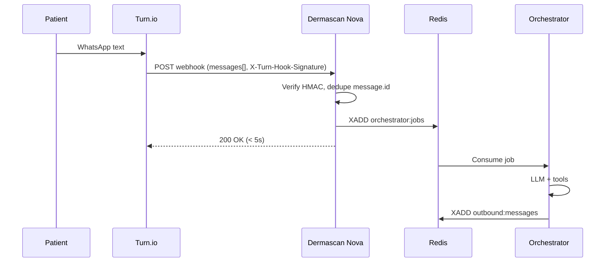
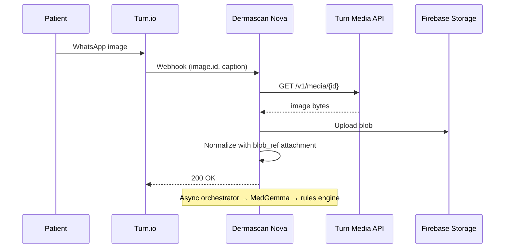
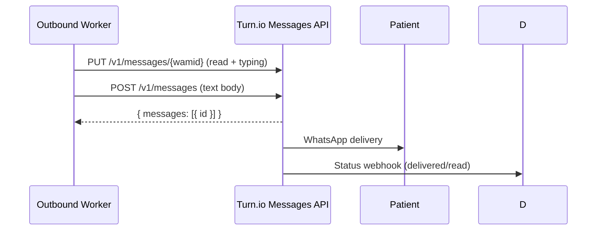
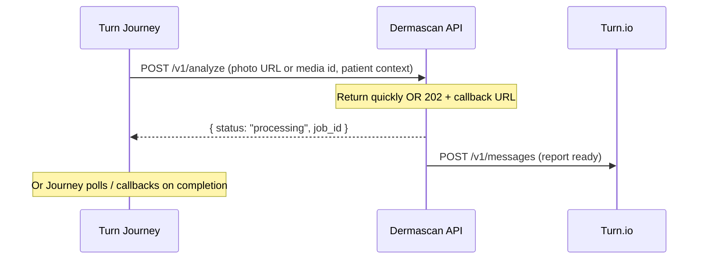
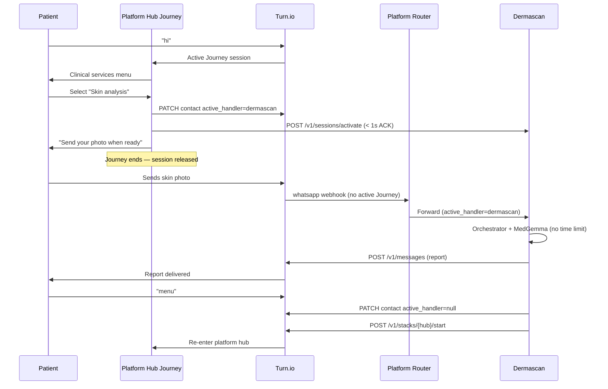

# Turn.io WhatsApp Integration — Research & Alignment Guide

> **Context:** Dermascan currently routes WhatsApp through a **360Dialog** sidecar (`qutis-whatsapp-api`). The hosting healthcare platform uses **Turn.io**. This document summarizes Turn.io's WhatsApp Business API, how it aligns with our system, and the additional platform tools relevant to a healthcare integration.

**Official docs:** [https://whatsapp.turn.io/docs/](https://whatsapp.turn.io/docs/)  
**Tutorials:** [https://learn.turn.io](https://learn.turn.io)

---

## Executive Summary


| Dimension                   | Verdict                                                                                                                                                                      |
| --------------------------- | ---------------------------------------------------------------------------------------------------------------------------------------------------------------------------- |
| **API compatibility**       | **Strong.** Turn.io explicitly maps the Meta WhatsApp Business Platform (Cloud API) with Turn-specific extensions.                                                           |
| **Inbound webhooks**        | **Strong.** Payload shape matches what `_normalize_message()` already expects (`from`, `id`, `type`, `text.body`, `image.id`, etc.).                                         |
| **Outbound text**           | **Strong.** Direct `POST /v1/messages` replaces the sidecar `/send` contract with minimal adapter work.                                                                      |
| **Media (skin photos)**     | **Good.** Turn provides upload/retrieve endpoints; inbound webhooks include `image.id` + optional `link`. We must implement media fetch (currently deferred to the sidecar). |
| **Typing indicators**       | **Good.** Cloud API–compatible: `PUT /v1/messages/{id}` with `status: read` + `typing_indicator`. Replaces sidecar `/typing`.                                                |
| **Healthcare platform fit** | **Excellent.** HealthPass (FHIR R4), Helpdesk, Journeys, secure file delivery, and operator handoff align with dermatology escalation flows.                                 |
| **Migration complexity**    | **Low–medium.** Most change is in the sidecar layer (or removing it). Core orchestrator, Redis streams, and ingress models stay largely unchanged.                           |


**Recommendation:** Turn.io is a good fit. Prefer **direct Turn.io integration** (replace the 360Dialog sidecar) or a **thin Turn.io adapter sidecar** that preserves existing env vars (`WHATSAPP_API_BASE_URL`, ingress secret). Coexist with the platform's Turn.io Journeys via webhook routing or HTTP callbacks from Journeys into Dermascan.

---


## Current Dermascan WhatsApp Architecture

```
WhatsApp user
    → 360Dialog (waba-v2.360dialog.io)
    → qutis sidecar (:8000)          ← D360-API-KEY, media download
    → POST /v1/webhooks/whatsapp     ← Meta Cloud API–shaped payload
    → Redis orchestrator:jobs
    → orchestrator_worker (LLM + tools)
    → Redis outbound:messages
    → sidecar POST /send, /typing
    → 360Dialog → user
```

**What this repo owns:**


| Concern               | Location                                                         |
| --------------------- | ---------------------------------------------------------------- |
| Ingress webhook       | `dermascan/backend/api/endpoints.py`                             |
| Message normalization | `_normalize_message()` — expects Cloud API fields                |
| Outbound delivery     | `dermascan/backend/services/agents/outbound_sender_worker.py`    |
| Sidecar contract      | `POST /send` `{to, kind, text, reply_to_wamid?}`, `POST /typing` |


**What the sidecar owns today (not in this repo):** 360Dialog auth, webhook verification, media download, WABA management.

---


## Turn.io Platform Overview

Turn.io is a **WhatsApp-native healthcare engagement platform** (official Meta BSP). Beyond raw messaging API access, it provides:

- **Journeys** — no-code chatbot / care-path automation
- **Helpdesk** — human operator inbox, triage, AI-suggested replies, translations
- **HealthPass** — FHIR R4 integration for EMR/clinical data exchange (alpha)
- **WhatsApp Flows** — structured in-chat forms (surveys, intake, consent)
- **Contacts API** — patient profile store with custom schema fields
- **Data Export API** — date-range exports with scrubbing rules
- **Apps (Lua)** — custom server-side logic on Turn events (early access)

For a healthcare platform already on Turn.io, Dermascan can plug in as either:

1. A **webhook consumer/producer** on the same Turn.io number, or
2. An **external AI service** invoked from Turn Journeys via HTTP.

---


## API Alignment With Dermascan


### Authentication


| Current (360Dialog sidecar)  | Turn.io                                                                                          |
| ---------------------------- | ------------------------------------------------------------------------------------------------ |
| `D360-API-KEY` header        | `Authorization: Bearer <token>`                                                                  |
| Token managed in sidecar     | Create token in Turn UI → **Settings → API & Webhooks**                                          |
| Shared secret sidecar ↔ Nova | Keep `X-Internal-Secret` between adapter and Nova; add Turn webhook HMAC verification at adapter |


Turn also offers a Graph-style endpoint (`/graph/{version}/{phone_number_id}/`) with login-based tokens — prefer UI-generated Bearer tokens for production (they don't invalidate previous tokens).

### Inbound Messages (Webhook)

**Subscribe to:** `whatsapp` subscription (inbound + delivery status).

Turn forwards standard WhatsApp Enterprise Client events. Shape aligns with our normalizer:

```json
{
  "contacts": [{ "profile": { "name": "..." }, "wa_id": "254712345678" }],
  "messages": [{
    "from": "254712345678",
    "id": "wamid.xxx",
    "timestamp": "1518694700",
    "type": "text",
    "text": { "body": "I have a rash on my arm" }
  }]
}
```

**Image messages (skin snapshot use case):**

```json
{
  "from": "254712345678",
  "id": "wamid.xxx",
  "type": "image",
  "image": {
    "id": "media-id-uuid",
    "mime_type": "image/jpeg",
    "sha256": "...",
    "caption": "optional caption"
  }
}
```


| Dermascan field                 | Turn.io source             | Notes                          |
| ------------------------------- | -------------------------- | ------------------------------ |
| `client_id`                     | `message.from`             | E.164 digits, no `+`           |
| `message_id`                    | `message.id`               | wamid                          |
| `conversation_id`               | same as `client_id`        | unchanged                      |
| `content.text`                  | `text.body` + captions     | already handled                |
| `content.attachments`           | `image.id` / `document.id` | fetch via `GET /v1/media/{id}` |
| `metadata.extras.whatsapp_type` | `message.type`             | already handled                |


**Webhook requirements (critical for production):**

- Respond **2xx within 5 seconds** — enqueue to Redis immediately, process async (we already do this pattern).
- Verify `X-Turn-Hook-Signature` (HMAC-SHA256, base64) using webhook secret from Turn UI.
- Deduplicate on `message.id` — Turn recommends uniqueness checks.
- Slow endpoints get deprioritized to Turn's `low` queue (>1s response time).

**Headers on inbound webhooks:**


| Header                     | Purpose                                              |
| -------------------------- | ---------------------------------------------------- |
| `X-Turn-Hook-Subscription` | `whatsapp`, `turn`, `journey_outbound`, or `channel` |
| `X-Turn-Hook-Signature`    | Payload integrity verification                       |


### Outbound Text Messages

Replace sidecar `/send` with Turn.io Messages API:

```http
POST https://whatsapp.turn.io/v1/messages
Authorization: Bearer <token>
Content-Type: application/json

{
  "recipient_type": "individual",
  "to": "254712345678",
  "type": "text",
  "text": { "body": "Your skin snapshot is ready..." },
  "preview_url": false
}
```

**Response:**

```json
{ "messages": [{ "id": "wamid.HBgLM..." }] }
```


| Sidecar field    | Turn.io equivalent                                                                    |
| ---------------- | ------------------------------------------------------------------------------------- |
| `to`             | `to` (digits, no `+`)                                                                 |
| `kind: "text"`   | `type: "text"`                                                                        |
| `text` (string)  | `text.body` (object)                                                                  |
| `reply_to_wamid` | Use `context.message_id` in payload, or `X-Turn-In-Reply-To` header for audit linking |


**Reply threading (signal updates):** For progress/status messages that should thread, include:

```json
{
  "to": "254712345678",
  "type": "text",
  "context": { "message_id": "wamid.inbound-id" },
  "text": { "body": "Analyzing your photo..." }
}
```

Or set header `X-Turn-In-Reply-To: <external-id>` for Turn's audit/training linkage (Turn does not validate the value).

**Important:** Turn outbound API is **synchronous** — success means Meta accepted the message. No queuing on Turn's side; our Redis outbound stream remains the reliability layer.

### Typing Indicators

Replace sidecar `POST /typing` with Cloud API read + typing:

```http
PUT https://whatsapp.turn.io/v1/messages/{inbound_wamid}
Authorization: Bearer <token>
Content-Type: application/json

{
  "status": "read",
  "typing_indicator": { "type": "text" }
}
```

Clears automatically after 25 seconds or when the next message is sent. Only show when a reply is imminent (matches our current best-effort behavior).

### Media Flow (Inbound Skin Photos)

Turn downloads media when a message arrives; webhook includes `image.id`. To resolve for MedGemma:

```
1. Webhook arrives with image.id
2. GET https://whatsapp.turn.io/v1/media/{id}   → returns binary or redirect URL
3. Store in Firebase (existing _store_whatsapp_image_attachment flow)
4. Enqueue orchestrator job with blob_ref attachment
```

Turn also stores media permanently and re-uploads to Meta's ~30-day cache transparently — useful for journey references and re-analysis.

**Upload limits (post-processing):** images ≤ 5 MB, documents ≤ 100 MB. Matches our 5 MB ingress validation.

### Delivery Status Webhooks

Subscribe to `whatsapp` subscription to receive status events:

```json
{
  "statuses": [{
    "id": "wamid.xxx",
    "status": "sent|delivered|read|failed",
    "timestamp": "1518694700",
    "recipient_id": "254712345678"
  }]
}
```

Not used today but valuable for observability and failed-message alerting.

### Templates (24-Hour Window)

We currently send **session messages only** (within the 24-hour customer care window). Turn supports templates via the same `/v1/messages` endpoint with `type: "template"` — needed if:

- Platform Journeys trigger Dermascan after 24h silence
- Proactive care reminders (medication, follow-up skin checks)
- Specialist escalation when the session expired

Template namespace is visible in Turn UI → Settings → API & Webhooks → Message Template API details.

### Interactive Messages & WhatsApp Flows

Turn supports buttons, lists, and **WhatsApp Flows** (structured forms). Potential healthcare uses:

- Consent capture before skin analysis
- Structured symptom intake (location, duration, severity)
- Post-analysis satisfaction survey
- Appointment booking handoff to platform Journeys

Not required for initial migration but aligns with orchestrator menu flows (`orchestrator_prompt.py`).

---


## Integration Architecture Options


### Option A — Direct Turn.io Adapter (Recommended)

Replace the 360Dialog sidecar with a thin **Turn.io adapter** (or extend Nova to call Turn directly):

```
WhatsApp user
    → Turn.io
    → [optional adapter] verify HMAC, fetch media
    → POST /v1/webhooks/whatsapp  (unchanged contract)
    → orchestrator → outbound
    → POST https://whatsapp.turn.io/v1/messages
    → Turn.io → user
```

**Pros:** Minimal orchestrator changes; keeps Redis reliability; clear separation.  
**Cons:** Still maintain a small adapter service for HMAC + media fetch.

### Option B — Turn.io Webhook Direct to Nova

Configure Turn primary webhook → Nova `/v1/webhooks/whatsapp` directly.

**Required Nova changes:**

- Add `X-Turn-Hook-Signature` verification
- Parse Turn's flat webhook body (`messages[]` at top level, not always wrapped in `entry[].changes[]`)
- Implement `GET /v1/media/{id}` in ingress path for `whatsapp_media_id` attachments
- Point outbound worker at `https://whatsapp.turn.io/v1/messages` with Bearer token

**Pros:** Fewest moving parts.  
**Cons:** Nova gains WhatsApp provider coupling; media fetch adds latency to webhook handler unless async.

### Option C — Embedded in Platform Journeys

Platform Journeys handle routing, consent, and handoff; Dermascan is an HTTP backend:

```
Patient → Turn Journey (consent, triage)
    → HTTP POST to Dermascan /v1/analyze (Journey card)
    → Dermascan returns report text
    → Journey sends reply OR Journey calls /v1/messages via Turn
```

Journey HTTP cards add headers automatically:

- `X-Turn-Journey-UUID`
- `X-Turn-Journey-Session-UUID`
- `X-Turn-Journey-Environment` (`staging` | `production`)

**Journey HTTP limits:** max **20s** timeout; prefer **<10s** responses. Long MedGemma runs must be async (Journey waits on webhook callback or polls).

**Pros:** Native to healthcare platform; operators see chats in Helpdesk.  
**Cons:** Journey timeout constraints; split state between Turn and Dermascan.

### Option D — Hybrid (Recommended Production Shape)


| Flow                                                         | Handler                                                                    |
| ------------------------------------------------------------ | -------------------------------------------------------------------------- |
| Platform clinical hub (appointments, labs, meds, menu)       | Turn Journeys (platform-owned, code-first DSL)                             |
| Skin analysis (user selects from hub)                        | **Handoff → Dermascan** via webhook (normal messaging, no Journey session) |
| Full Dermascan conversation (photos, reports, product check) | Dermascan orchestrator on `whatsapp` webhook                               |
| Specialist escalation                                        | Dermascan → platform Helpdesk (existing HMAC escalation webhook)           |
| Return to platform menu                                      | Dermascan clears routing flag → re-enter hub Journey                       |
| Proactive follow-up (>24h)                                   | Turn Journey + template → optional Dermascan handoff                       |


---


## Basic API Integration Flows


### Flow 1 — Inbound Text Message




### Flow 2 — Inbound Image (Skin Snapshot)




### Flow 3 — Outbound Reply




### Flow 4 — Journey-Triggered Analysis




### Flow 5 — Start Platform Journey After Dermascan Escalation

```http
POST https://whatsapp.turn.io/v1/stacks/{journey_uuid}/start
Authorization: Bearer <token>
Content-Type: application/json

{
  "wa_id": "254712345678",
  "message_id": "wamid.reference-message"
}
```

**Constraints:**

- Contact must have messaged the service before
- Cannot start if contact has an active Turn session (unless platform overrides)
- After 24h, journey must begin with a **template message**

Useful for handing escalated cases into a platform "specialist review" Journey.

---


## Healthcare Platform Tools (Beyond Raw Messaging)


### HealthPass — FHIR R4 Integration (Alpha)

Turn's HealthPass connects Turn.io to EMR systems via standard FHIR R4. Relevant if the platform stores patient records and Dermascan needs clinical context.

**Supported resources:**


| Resource            | Use in dermatology context                        |
| ------------------- | ------------------------------------------------- |
| `Patient`           | Identity, phone, demographics                     |
| `Observation`       | Store skin assessment scores, lesion measurements |
| `Condition`         | Diagnosis codes (ICD/SNOMED) from rules engine    |
| `MedicationRequest` | Product safety / contraindication context         |
| `Appointment`       | Specialist escalation → booked consult            |
| `Practitioner`      | Route escalation to dermatologist                 |
| `RelatedPerson`     | Parent/guardian for pediatric cases               |
| `DiagnosticReport`  | Formal report delivery                            |


**Integration pattern:** Platform EMR ↔ HealthPass ↔ Turn contacts/Journeys. Dermascan writes `Observation`/`Condition` via platform API or receives patient context in Journey HTTP calls.

Docs: [HealthPass FHIR API Guide](https://whatsapp.turn.io/docs/apps/healthpass/fhir-api)

### Helpdesk (Human Operators)

Aligns with existing **specialist escalation** flow (`POST /v1/webhooks/escalation`):


| Turn Helpdesk feature | Dermascan equivalent                        |
| --------------------- | ------------------------------------------- |
| Operator inbox        | Escalation dashboard                        |
| Triage collections    | Escalation queues by severity               |
| AI-suggested replies  | Could augment physician responses           |
| PII masking           | Matches healthcare privacy needs            |
| Secure file delivery  | Lab results, prescriptions (platform-owned) |
| EMR/CRM data pull     | HealthPass / contact fields                 |


**Coexistence:** Dermascan handles AI triage; platform Helpdesk handles physician review on the same Turn number. Use contact custom fields (e.g. `dermascan_case_id`, `escalation_status`) to sync state.

### Journeys (Care Path Automation)


| Capability                  | Healthcare example                                  |
| --------------------------- | --------------------------------------------------- |
| Code-first flows (DSL)      | Consent, routing, handoff to Dermascan — see below  |
| No-code canvas              | Optional; same runtime as code journeys             |
| Conditional routing         | Low-confidence audit → human handoff Journey        |
| Scheduling                  | Follow-up skin check in 4 weeks                     |
| AI assistants (OpenAI/Meta) | Platform FAQ; Dermascan for clinical image analysis |
| HTTP integrations           | Call Dermascan endpoints from Journey cards         |
| Surveys / data capture      | Patient-reported outcomes                           |


**Start journey via API:** `POST /v1/stacks/{uuid}/start`

Docs: [Journeys API](https://whatsapp.turn.io/docs/api/stacks) | [HTTP in Journeys](https://whatsapp.turn.io/docs/journeys/api_integrations)

---


### Code-First Journeys

Turn.io supports **code-first Journeys** as a first-class option. The no-code canvas is optional — both compile to the same runtime.

**Ownership model:** Journeys belong to the **healthcare platform** (appointments, labs, medication, clinical hub menu). Dermascan is an **external service invoked on selection**, not a Journey owner. See [Journey → Dermascan handoff](#journey--dermascan-handoff-release-to-normal-messaging) below.


| Mode               | How you build                       | API response flag    |
| ------------------ | ----------------------------------- | -------------------- |
| **Code Journey**   | Journeys DSL in a `notebook` string | `"is_canvas": false` |
| **Canvas Journey** | Visual drag-and-drop builder        | `"is_canvas": true`  |


Turn's own guidance for technical teams: keep journey notebooks in **Git**, deploy via CI, and unit-test with the **Simulation API**.

### Journeys DSL (the “code”)

Journeys are written in Turn's **Journeys DSL** — a small custom language (Elixir-inspired syntax). It is **not** Python or TypeScript.

```elixir
stack MyJourney do
  card Welcome do
    text("Hello!")
    then(Next)
  end

  card Next do
    text("Next step.")
  end
end
```

**Core concepts:**


| Concept                        | Purpose                                                            |
| ------------------------------ | ------------------------------------------------------------------ |
| `stack`                        | Journey container                                                  |
| `card`                         | One step (send message, ask question, HTTP call, branch)           |
| `then(CardName)`               | Unconditional next card                                            |
| `then(Card when condition)`    | Conditional branch                                                 |
| `trigger(on: "...")`           | When the journey starts (message, first-time, catch-all, schedule) |
| `ask("question")`              | Wait for user text reply                                           |
| `buttons([A, B]) do ... end`   | Quick-reply buttons                                                |
| `get/post/put/patch(url, ...)` | HTTP calls to external APIs (Dermascan)                            |
| `log("...")`                   | Debug output in simulator / journey logs                           |


Full language reference: [Journeys overview](https://whatsapp.turn.io/docs/journeys/journeys_overview)

### REST API — create, update, deploy

**Requires Turn.io Enterprise plan** for create / update / publish.

```bash
# Create a code journey (auto-publishes on create — use enabled: false until ready)
curl -X POST https://whatsapp.turn.io/v1/stacks \
  -H "Authorization: Bearer $TURN_API_TOKEN" \
  -H "Content-Type: application/json" \
  -d @- <<'EOF'
{
  "name": "Dermascan Intake",
  "enabled": false,
  "notebook": "stack DermascanIntake do\n  card Welcome do\n    text(\"Hello\")\n  end\nend"
}
EOF

# Update notebook from repo file (unpublished until you publish)
curl -X PATCH "https://whatsapp.turn.io/v1/stacks/{uuid}" \
  -H "Authorization: Bearer $TURN_API_TOKEN" \
  -H "Content-Type: application/json" \
  -d "{\"notebook\": $(jq -Rs . < turn/journeys/dermascan_intake.md), \"publish_latest_changes\": true}"

# Export current production notebook
curl "https://whatsapp.turn.io/v1/stacks/{uuid}?format=md" \
  -H "Authorization: Bearer $TURN_API_TOKEN"
```

**Deploy workflow (recommended):**

```
turn/journeys/*.md  →  CI (validate + simulate)  →  PATCH /v1/stacks/{uuid}  →  POST /publish
```

On create, Turn **auto-publishes** the first revision. Safe rollout pattern:

1. Create with `"enabled": false` and **no trigger** in the notebook.
2. Test via Simulation API.
3. Add trigger in a PATCH with `"publish_latest_changes": true`.
4. Set `"enabled": true`.


### Simulation API — test without WhatsApp

Run published journeys in memory — no messages sent, no contact side effects:

```bash
# Start simulation
curl -X POST "https://whatsapp.turn.io/v1/journeys/{uuid}/simulation" \
  -H "Authorization: Bearer $TURN_API_TOKEN" \
  -H "Content-Type: application/json" \
  -d '{"simulation_id": "test-001", "revision": "staging"}'

# Send user reply (reuse same simulation_id)
curl -X POST "https://whatsapp.turn.io/v1/journeys/{uuid}/simulation" \
  -H "Authorization: Bearer $TURN_API_TOKEN" \
  -H "Content-Type: application/json" \
  -d '{"simulation_id": "test-001", "input": "Skin snapshot"}'
```

Use in CI: deploy notebook → simulate menu → photo path → assert escalation branch.

Docs: [Simulation API](https://learn.turn.io/l/en/article/ghbu0251ea-test-your-journeys-with-the-simulation-api)

### Split of responsibilities: Platform Journey vs Dermascan


| Layer                        | Owns                                                                           |
| ---------------------------- | ------------------------------------------------------------------------------ |
| **Platform Journeys (DSL)**  | Clinical services hub, appointments, lab delivery, meds, FAQ, Helpdesk routing |
| **Dermascan (webhook mode)** | Skin/product analysis, MedGemma, rules engine, reports, escalation logic       |
| **Turn Helpdesk**            | Human clinician review (platform UI)                                           |


Dermascan should **never run inside a Journey card** for anything that takes more than a few seconds. The Journey only **activates** Dermascan and **releases the session**.

### Journey → Dermascan handoff (release to normal messaging)

This is the recommended pattern to avoid the **20s Journey HTTP limit** and active-session conflicts.




**Step-by-step:**

1. **Hub Journey running** — user picks a clinical service from the platform menu (appointments, labs, skin analysis, etc.).
2. **Handoff card (fast, < 20s total):**
  - `PATCH` contact profile: `active_handler = "dermascan"` (or `"appointments"`, etc.)
  - Optional: `POST` Dermascan `/v1/sessions/activate` — lightweight ACK that primes Redis session state (must return in **< 1s**)
  - Send a short handoff message: *"You're connected to skin analysis. Send a photo when ready."*
  - **End the Journey** — terminal card with no `then`; enable Turn setting *"automatically close journey chats"*
3. **Normal messaging mode** — with no active Journey session, inbound messages hit the `whatsapp` webhook subscription.
4. **Platform router** (thin adapter or Turn App) reads `contact.active_handler`:
  - `"dermascan"` → forward to `POST /v1/webhooks/whatsapp`
  - `null` / `"platform"` → ignore or re-trigger hub Journey (`CATCH ALL` trigger)
5. **Dermascan runs freely** — orchestrator, MedGemma, Redis, outbound replies via `POST /v1/messages`. No Journey timeout.
6. **Return to platform** — when user sends `"menu"` or Dermascan completes:
  - Dermascan `PATCH`es `active_handler = null`
  - Dermascan or platform calls `POST /v1/stacks/{hub_uuid}/start` to re-enter the clinical hub

**Why not keep the user inside the Journey?**


| Approach                                               | Problem                                                         |
| ------------------------------------------------------ | --------------------------------------------------------------- |
| HTTP `post()` to Dermascan inside Journey for analysis | **20s hard ceiling**; MedGemma takes longer                     |
| Journey `wait` + Turn App callback                     | Works but couples Dermascan to Journey lifecycle unnecessarily  |
| Conversation claiming (`X-Turn-Claim`)                 | **5-minute lease** — must extend repeatedly; sidesteps webhooks |


**Releasing the Journey session** is the cleanest path: Dermascan behaves like today (webhook in, API out), while the platform Journey only handles routing.

**Turn.io settings to confirm with platform team:**

- Enable *automatically close journey chats* after non-operator journeys complete
- Hub Journey uses `CATCH ALL` or keyword trigger only when `active_handler` is empty (expression on trigger)
- Primary `whatsapp` webhook points to platform router (or Dermascan when router is embedded in adapter)
- Do **not** subscribe Dermascan ingress to Journey `post()` for photos — photos arrive via webhook after handoff

**Emergency session release** (stuck Journey): `DELETE /v1/contacts/{wa_id}/claim`

Docs: [Conversation claiming](https://whatsapp.turn.io/docs/api/extensions) (short leases only) | [Inbox routing / journey pause](https://learn.turn.io/l/en/article/jynv5tspbm-14-nov-inbox-routing-improvements)

### Dermascan activation endpoint (new, minimal)

The Journey handoff should call a **fast activation endpoint**, not the full ingress with a photo:

```http
POST /v1/sessions/activate
X-Internal-Secret: <secret>
Content-Type: application/json

{
  "wa_id": "254712345678",
  "service": "dermascan",
  "source": "platform_hub",
  "consent_at": "2026-09-16T08:00:00Z"
}
```

Response (must be **< 1s**):

```json
{ "status": "active", "handler": "dermascan" }
```

This endpoint only sets session/routing state in Redis — no AI work. All subsequent messages arrive via the normal Turn webhook.

### Starter notebook (platform hub, not Dermascan-owned)

Example **clinical services hub** with skin-analysis handoff:

`[turn/journeys/clinical_services_hub.md](turn/journeys/clinical_services_hub.md)`

The notebook covers hub menu → service selection → contact-field routing → session release. It does **not** process photos or run analysis inside the Journey.

### Code-first vs canvas — when to use which


| Prefer **code (DSL)**                         | Prefer **canvas**                                 |
| --------------------------------------------- | ------------------------------------------------- |
| Git review, CI/CD, Simulation tests           | Rapid prototyping with non-technical stakeholders |
| Complex HTTP / branching logic                | Visual demo for clinical advisors                 |
| Multi-environment promote (staging → prod)    | One-off campaign Journeys                         |
| Platform engineering owns hub Journeys in Git | Clinical advisors prototype in canvas first       |


---


### Contacts API — Patient Profile Store

Store Dermascan-specific metadata on Turn contacts:

```http
PATCH https://whatsapp.turn.io/v1/contacts/254712345678/profile
Authorization: Bearer <token>
Content-Type: application/json

{
  "last_skin_audit_at": "2026-09-16T08:00:00Z",
  "last_audit_tier": "WATCH",
  "dermascan_consent": true
}
```

Custom fields require schema setup via `POST /v1/contacts/schemas`. Bulk import via CSV (`urn` column = phone number).

Useful for:

- Platform segmentation (chronic patients, high-risk)
- Journey triggers based on `last_audit_tier`
- Consent tracking before analysis


### WhatsApp Flows

Structured in-chat forms for intake/consent without free-text parsing:

```http
POST https://whatsapp.turn.io/v1/messages
{
  "to": "254712345678",
  "type": "interactive",
  "interactive": {
    "type": "flow",
    "body": { "text": "Complete a quick skin intake form" },
    "action": {
      "name": "flow",
      "parameters": {
        "flow_id": "...",
        "flow_cta": "Start",
        "flow_action": "navigate",
        "flow_action_payload": { "screen": "INTAKE_START" }
      }
    }
  }
}
```

Flow results accessible via [Flow Results API](https://whatsapp.turn.io/docs/api/flow_results).

### Data Export API

Export conversation and contact data by date range for audit, research, and compliance. Supports scrubbing rules. Replaces deprecated `/v1/export/contacts/details`.

### Turn.io Apps (Lua, Early Access)

Server-side apps that react to Turn events (`on_event`). Capabilities include:

- `turn.journeys.start()` — route contacts between journeys
- `turn.contacts.update_contact_details()` — sync escalation state
- `turn.http.server` — receive external webhooks (e.g. Dermascan completion callbacks)
- `turn.leases.send_input()` — resume paused journeys after async work

Relevant for async MedGemma jobs: Journey pauses (`return "wait"`), Dermascan calls back, App resumes Journey with results.

---


## Side-by-Side: 360Dialog vs [Turn.io](http://Turn.io)


| Feature             | 360Dialog (current)    | Turn.io                               |
| ------------------- | ---------------------- | ------------------------------------- |
| Base URL            | `waba-v2.360dialog.io` | `whatsapp.turn.io`                    |
| Auth                | `D360-API-KEY`         | `Authorization: Bearer`               |
| Send message        | `/messages`            | `/v1/messages`                        |
| Media upload        | Meta-compatible        | `/v1/media` (permanent storage)       |
| Media retrieve      | Meta-compatible        | `/v1/media/{id}`                      |
| Webhook format      | Cloud API              | Cloud API (+ Turn headers)            |
| Webhook verify      | Partner-specific       | `X-Turn-Hook-Signature` (HMAC-SHA256) |
| Typing              | Via partner/sidecar    | `PUT /v1/messages/{id}`               |
| Templates           | Yes                    | Yes (`type: template`)                |
| Journeys / Helpdesk | No                     | Yes (platform-native)                 |
| FHIR / EMR          | No                     | HealthPass (alpha)                    |
| Contacts CRM        | No                     | Contacts API + schema                 |
| Rate limiting       | Partner tiers          | Per-number (see Turn rate limit docs) |


---


## Migration Checklist


### Phase 1 — Adapter / Proof of Concept

- [ ] Obtain Turn.io Bearer token from platform team (Settings → API & Webhooks)
- [ ] Configure webhook URL → staging Nova or adapter
- [ ] Subscribe to `whatsapp` webhook events
- [ ] Verify HMAC signature validation
- [ ] Send test inbound text → confirm orchestrator job
- [ ] Send test inbound image → implement media fetch → confirm MedGemma path
- [ ] Send outbound text via `POST /v1/messages`
- [ ] Replace `/typing` with `PUT /v1/messages/{id}` typing indicator


### Phase 2 — Production Cutover

- [ ] Swap `WHATSAPP_API_BASE_URL` to Turn adapter or direct Turn URL
- [ ] Update outbound worker payload mapping (`text` → `text.body`, etc.)
- [ ] Add delivery status webhook handling (optional)
- [ ] Load-test webhook response time (<200ms ack target for high-priority queue)
- [ ] Decommission 360Dialog API key and sidecar


### Phase 3 — Platform Integration

- [ ] Define contact custom fields (`active_handler`, `dermascan_consent`) with platform team
- [ ] Deploy platform clinical hub Journey (code-first, Git-managed)
- [ ] Implement handoff: hub sets `active_handler=dermascan` → Journey ends → webhook routing
- [ ] Add Dermascan `POST /v1/sessions/activate` (fast ACK, no AI)
- [ ] Implement return-to-hub: `"menu"` clears handler + `POST /v1/stacks/{hub}/start`
- [ ] Wire escalation to Helpdesk collections
- [ ] HealthPass: agree which FHIR resources Dermascan writes vs platform owns
- [ ] Template messages for >24h follow-up flows

---


## Environment Variable Mapping


| Current env var                | Turn.io migration                                         |
| ------------------------------ | --------------------------------------------------------- |
| `WHATSAPP_API_BASE_URL`        | `https://whatsapp.turn.io` (or keep adapter URL)          |
| `WHATSAPP_API_SEND_PATH`       | `/v1/messages`                                            |
| `WHATSAPP_API_TYPING_PATH`     | `/v1/messages/{message_id}` (PUT, not POST)               |
| `WHATSAPP_INTERNAL_API_SECRET` | Replace with `TURN_API_TOKEN` (Bearer) for outbound       |
| `WHATSAPP_INGRESS_SECRET`      | Keep for Nova ingress; add `TURN_WEBHOOK_SECRET` for HMAC |
| `WHATSAPP_MEDIA_PATH`          | `/v1/media/{id}` (implement in adapter or Nova)           |


Suggested new vars:

```bash
TURN_API_BASE_URL=https://whatsapp.turn.io
TURN_API_TOKEN=                    # Bearer token for outbound
TURN_WEBHOOK_SECRET=               # HMAC secret from Turn webhook config
TURN_WEBHOOK_SUBSCRIPTION=whatsapp # whatsapp | turn | journey_outbound
```

---


## Risks & Mitigations


| Risk                                         | Mitigation                                                           |
| -------------------------------------------- | -------------------------------------------------------------------- |
| Webhook 5s timeout                           | Ack immediately after Redis enqueue (existing pattern)               |
| Journey HTTP 20s limit                       | Async job + callback or Turn App `wait`/`send_input`                 |
| Active Turn session blocks API journey start | Coordinate routing rules with platform; use `override` in Apps       |
| 24h window expiry                            | Platform templates for re-engagement; Journey triggers               |
| Media fetch adds ingress latency             | Fetch media async in adapter; enqueue with `whatsapp_media_id` first |
| Token rotation                               | Use Turn UI tokens (non-destructive); avoid Graph login in prod      |
| Dual webhook delivery                        | Don't subscribe to both `whatsapp` and `channel` on same endpoint    |


---


## Code Touchpoints (This Repo)


| File                                     | Change for Turn.io                                               |
| ---------------------------------------- | ---------------------------------------------------------------- |
| `outbound_sender_worker.py`              | Map `_send_whatsapp()` to `POST /v1/messages`; typing via PUT    |
| `endpoints.py`                           | Optional HMAC verify; handle Turn flat webhook body; media fetch |
| `.env_example`                           | Add `TURN_*` vars                                                |
| `turn/journeys/clinical_services_hub.md` | Platform hub Journey with Dermascan handoff (session release)    |
| Sidecar (external)                       | Replace 360Dialog with Turn.io or remove entirely                |


**Unchanged:** orchestrator logic, Redis streams, `_normalize_message()` field mapping, escalation HMAC webhook, concise report formatting.

---


## References


| Topic                         | URL                                                                                                                                                                                      |
| ----------------------------- | ---------------------------------------------------------------------------------------------------------------------------------------------------------------------------------------- |
| API overview                  | [https://whatsapp.turn.io/docs/category/turn-api](https://whatsapp.turn.io/docs/category/turn-api)                                                                                       |
| Authentication                | [https://whatsapp.turn.io/docs/api/authentication](https://whatsapp.turn.io/docs/api/authentication)                                                                                     |
| Messages                      | [https://whatsapp.turn.io/docs/api/messages](https://whatsapp.turn.io/docs/api/messages)                                                                                                 |
| Media                         | [https://whatsapp.turn.io/docs/api/media](https://whatsapp.turn.io/docs/api/media)                                                                                                       |
| Webhooks                      | [https://whatsapp.turn.io/docs/api/webhooks](https://whatsapp.turn.io/docs/api/webhooks)                                                                                                 |
| API extensions                | [https://whatsapp.turn.io/docs/api/extensions](https://whatsapp.turn.io/docs/api/extensions)                                                                                             |
| Contacts                      | [https://whatsapp.turn.io/docs/api/contacts](https://whatsapp.turn.io/docs/api/contacts)                                                                                                 |
| Journeys overview (DSL)       | [https://whatsapp.turn.io/docs/journeys/journeys_overview](https://whatsapp.turn.io/docs/journeys/journeys_overview)                                                                     |
| Journeys API                  | [https://whatsapp.turn.io/docs/api/stacks](https://whatsapp.turn.io/docs/api/stacks)                                                                                                     |
| Journey HTTP integrations     | [https://whatsapp.turn.io/docs/journeys/api_integrations](https://whatsapp.turn.io/docs/journeys/api_integrations)                                                                       |
| Journeys Simulation API       | [https://learn.turn.io/l/en/article/ghbu0251ea-test-your-journeys-with-the-simulation-api](https://learn.turn.io/l/en/article/ghbu0251ea-test-your-journeys-with-the-simulation-api)     |
| Journey REST API announcement | [https://learn.turn.io/l/en/article/aaenwqe7u2-10-sep-2024-journey-rest-api](https://learn.turn.io/l/en/article/aaenwqe7u2-10-sep-2024-journey-rest-api)                                 |
| Turn.io Apps (Lua)            | [https://whatsapp.turn.io/docs/category/apps](https://whatsapp.turn.io/docs/category/apps)                                                                                               |
| HealthPass FHIR               | [https://whatsapp.turn.io/docs/apps/healthpass/fhir-api](https://whatsapp.turn.io/docs/apps/healthpass/fhir-api)                                                                         |
| WhatsApp Flows                | [https://whatsapp.turn.io/docs/api/whatsapp_flows](https://whatsapp.turn.io/docs/api/whatsapp_flows)                                                                                     |
| Webhook failure alerts        | [https://learn.turn.io/l/en/article/ua3s7zn5v1-why-are-you-receiving-webhook-failure-alerts](https://learn.turn.io/l/en/article/ua3s7zn5v1-why-are-you-receiving-webhook-failure-alerts) |
| Turn.io product (healthcare)  | [https://www.turn.io/](https://www.turn.io/)                                                                                                                                             |


---

*Generated for Dermascan migration planning — September 2026.*